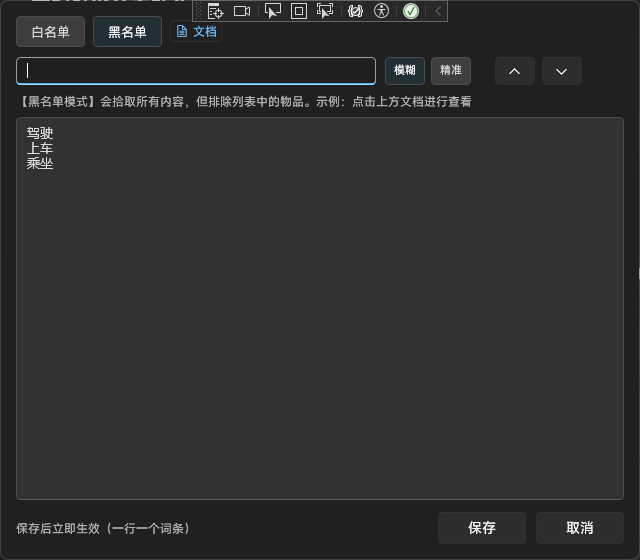
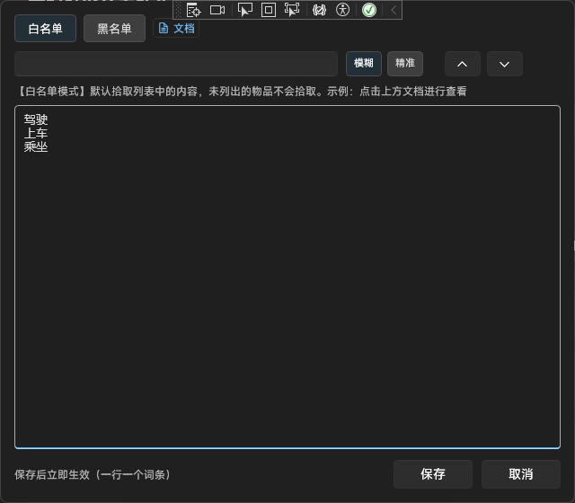

# 📋 自动拾取 · 黑白名单使用说明

> 适用：自动拾取功能（OCR 引擎） · 保存后**立即生效**，无需重启

---

## 🎯 两种模式

### ⚪ 白名单模式 ——「只拿我点的」

只有出现在**白名单**里的词条才会被自动拾取，未列出的内容一律不动手。
适合精准控制，例如只拾取：`驾驶` / `上车` / `乘坐`。

### ⚫ 黑名单模式 ——「除了我讨厌的都拿」

会拾取**所有**识别到的词条，但**黑名单**里的除外。
适合「大部分都要，只有几个不想拿」的场景。

## 📖 实例演示

### 实例① 白名单模式：只自动驾驶，别的都不碰

**配置**（模式选「白名单」，白名单填写）：

    驾驶
    上车
    乘坐

---

## ⚖️ 两条铁律

> **① 当前模式只看自己的名单**
> 白名单模式下，黑名单完全不参与判定；黑名单模式下，白名单完全不参与判定。
> 切换页签 = 切换规则，互不偷看。

> **② 同一名词同时出现在两份名单是合法的**
> 行为完全由当前模式决定（见下面实例③），无需纠结。

---

**运行效果**：

- 画面出现「F 驾驶」 → ✅ 自动按 F（`驾驶` 在白名单里）
- 画面出现「F 上车」 → ✅ 自动按 F
- 画面出现「F 拾取」 → ❌ 不动手（不在白名单 = 未放行）
- 画面出现「前往 LG1」 → ❌ 不动手（安全豁免，见下文）

### 实例② 黑名单模式：全都要，除了这几个

**配置**（模式选「黑名单」，黑名单填写）：

    星冢
    娜娜莉
    安魂曲

**运行效果**：

- 画面出现「拾取 星冢」 → ❌ 拒绝（在黑名单里）
- 画面出现「拾取 娜娜莉」 → ❌ 拒绝
- 画面出现「拾取 铁矿石」 → ✅ 自动按 F（不在黑名单 = 放行）
- 此时白名单写了什么、甚至是不是空的，**完全无关**

### 实例③ 同名词同时在两份名单：互不偷看的实证

**配置**：白名单和黑名单里**都**写了 `驾驶`

- 切到 **白名单模式** → ✅ 拾取（白名单放行，不看黑名单）
- 切到 **黑名单模式** → ❌ 拒绝（黑名单拦截，不看白名单）

> 同一份配置，切个页签行为就反转 —— 这就是「两条铁律」的实证。

### 实例④ 包含匹配：词条要「短」，画面要「长」

匹配方向是：**画面文本包含词条** 才算命中。

**配置**（白名单）：`驾驶`

- 画面「F 驾驶」 → ✅ 命中（键帽字符不影响）
- 画面「驾驶位有人」 → ✅ 命中（包含 `驾驶` —— ⚠️ 宽松命中，不想误触就把词条写精确）
- 词条写成 `F驾驶` → ❌ 不推荐：OCR 对键帽符号识别不稳（F 可能读成别的字符），**词条写纯名词才稳**

> 💡 结论：词条写**纯名词**（如 `驾驶`），不带键帽、不带空格、不带标点。

---

## 🔍 匹配规则

- **包含匹配**：词条是识别文本的一部分即算命中（见实例④）
- **自动归一化**：全角/半角、大小写、首尾空格自动忽略
  `Ｆ　驾驶`、`drive`、` 驾驶 ` 视为相同
- **填写格式**：一行一个词条；行内也可以用逗号分隔：`驾驶, 上车、乘坐`

---

## 🚦 空名单行为

- **白名单为空** → 一个都不拾取（防止误触乱按键）
- **黑名单为空** → 全部拾取（黑名单模式的自然语义）

---

## 🛡️ 安全豁免（不可配置）

以下菜单 / 导航类提示**永远不会**被自动按键，无论名单怎么写：

`前往` · `传送` · `聊天` · `设置`

> 💡 这是防误触保护：自动传送到未知地点的代价，远大于少捡一个东西。

---

## 🔎 搜索功能

名单变长后快速定位词条：

- 输入关键词，选 **模糊**（包含即命中）或 **精准**（整行完全一致）
- `Enter` 下一个 · `Shift+Enter` 上一个 · 右侧箭头按钮同样有效
- 右侧显示 `当前/总数`；无结果时搜索框变红

---

## ❓ 常见问题

**Q：明明在名单里，为什么不拾取？**

1. ① 确认当前模式正确：白名单模式 = 必须在白名单里
2. ② 确认已点「保存」（保存后立即生效）
3. ③ 打开日志窗口（开发者模式），看是否出现「名单未放行」
4. ④ 都没有 → 可能 OCR 未识别出文本，确认拾取引擎为 OCR

**Q：保存后重开窗口，空行没了 / 顺序变了？**

保存时会自动清理空行和首尾空格，属正常行为，不影响匹配。
