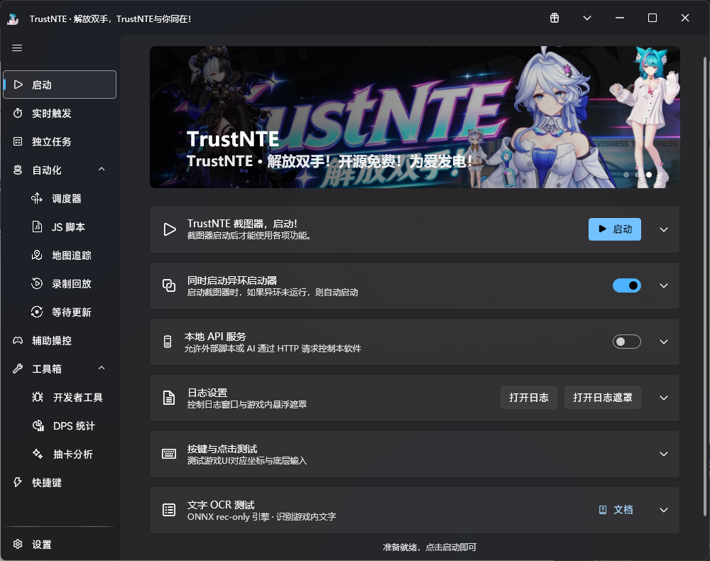
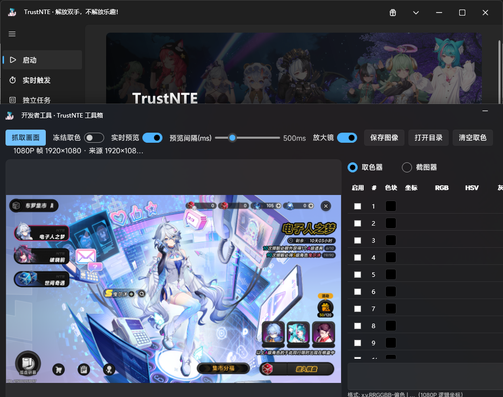

# TrustNTE

**面向《异环》（Neverness to Everness）的开源自动化与游戏分析工具**

> 让异环解放双手，把自由时间还给自己。  
> Free your hands, reclaim your time.

TrustNTE 基于 C#、.NET 8、WPF 与 MVVM 架构构建，集游戏自动化、视觉识别、键鼠输入、DPS 战斗统计、抽卡记录分析、JavaScript 脚本、任务调度、键鼠录制和开发者工具于一体。项目免费、无广告，并持续完善各模块的稳定性与使用体验。

[下载发布版本](https://github.com/TrustNTE/TrustNTE/releases) · [项目仓库](https://github.com/TrustNTE/TrustNTE) · [问题反馈](https://github.com/TrustNTE/TrustNTE/issues)

[中文介绍](#中文介绍) | [English Introduction](#english-introduction)

## 软件预览

<div align="center">
  
  <br/><br/>
  
</div>

## 中文介绍

### 功能总览

| 模块 | 主要能力 |
| --- | --- |
| 启动与截图引擎 | 配置游戏路径、启动游戏、绑定窗口、画面捕获与分辨率归一化 |
| 实时触发 | 月卡与每日奖励领取、自动剧情、掉落拾取等实时自动化能力 |
| 独立任务 | 自动战斗、自动钓鱼、自动音游及其他可持续扩展的独立任务模块 |
| DPS 统计 | 实时战斗数据、角色与技能伤害、团队 DPS、时间线和轨外之境统计 |
| 抽卡分析 | 捕获并解析抽卡记录，按卡池统计出货情况，导出 JSON 数据 |
| 开发者工具 | 抓帧、实时预览、冻结取色、放大镜、框选截图、颜色与坐标分析 |
| JS 脚本 | 内置编辑器、语法检查、运行控制台、输入与视觉 API、停止与超时控制 |
| 调度器 | 分组管理、顺序执行、循环次数、运行状态、停止当前任务或跳过任务 |
| 录制器 | 录制键鼠事件、显示时长与事件数、保存带窗口和 DPI 信息的宏文件 |
| 辅助操控与快捷键 | 辅助操作入口、全局快捷键配置与快捷键统筹服务 |
| 设置与系统集成功能 | 多语言、明暗主题、开机自启、托盘运行、启动后自动执行和版本更新 |

> 不同版本的可用功能可能有所差异，请以当前发布版本的界面和发布说明为准。仍在开发或尚未完成接线的功能会在界面或本文档中注明。

### 游戏自动化

- **视觉识别**：结合 OpenCV、OCR、模板匹配、颜色识别与定制 YOLO 模型，为战斗和任务状态判断提供感知能力。
- **统一坐标体系**：将不同尺寸的游戏画面归一化到 1080P 逻辑坐标，视觉识别结果可直接用于点击和输入。
- **多种输入驱动**：支持物理、后台与 Trick 输入方式，并提供停止、异常和退出时的按键释放保护，降低卡键风险。
- **自动战斗**：目标识别、锁定目标、普通攻击、蓄力攻击、技能释放、角色切换与 Q 技能状态检测。
- **自动钓鱼**：钓鱼状态识别与控鱼操作，并围绕独立任务流程提供自动化支持。
- **自动剧情**：对话跳过、选项处理和剧情流程中的状态识别。
- **自动音游**：面向超强音玩法的自动循环与 DFJK 判定支持。
- **奖励与兑换**：月卡、每日奖励及兑换码相关入口，减少重复领取操作。
- **任务互斥与守护**：通过任务车道、引擎状态和停止保护，降低多个自动化流程同时操作造成的冲突。

### DPS 战斗统计

DPS 模块通过独立窗口提供战斗数据分析，由随程序部署的 `Nte-Dps.exe` Sidecar 负责核心协议与采集流程。

主要功能包括：

- 网卡探测与采集设备选择。
- Core、游戏进程和采集状态指示。
- 总伤害、团队 DPS、战斗时长、承受伤害、命中数和最大生命削减统计。
- 角色伤害排行、伤害占比与角色详情。
- 技能伤害构成、技能占比与战斗轴数据。
- 柱状图、折线图和占比图等可视化视图。
- 战斗时间线与轨外之境上、下半数据展示。
- 清空数据、停止采集和返回重新配置。

**使用前提：**该功能涉及本机网络流量捕获，需要安装 Npcap，并在使用前阅读软件内的风险告知。原始 PCAP 落盘默认关闭，统计数据默认在当前会话中处理。

### 抽卡分析

抽卡分析模块通过捕获本机与游戏服务器之间的数据包解析抽卡记录，不依赖本地游戏记录文件。

主要功能包括：

- 自动选择可用抓包后端；支持 Npcap，并在可用系统上尝试 Windows `pktmon`。
- 支持监听全部网卡或手动指定游戏流量所在网卡。
- 展示捕获包数、解码包数、记录数和采集时长。
- 按限定卡池、常驻卡池和弧盘池分类汇总。
- 统计各卡池总抽数、高稀有度出货数量及平均出货抽数。
- 展示高稀有度出货条目、出货日期和相邻出货之间的抽数。
- 将当前记录导出为带格式版本信息的 JSON 文件，便于备份和后续分析。

**注意：**抽卡记录来自当前抓包会话，开始采集前已经产生的历史记录不会凭空出现。抓包可能触发安全软件提示，请确认风险后再使用。

### 开发者工具

开发者工具面向模板制作、视觉调试和自动化脚本开发，提供：

- 单帧抓取与可调间隔的实时预览。
- 冻结画面取色，避免动态画面影响颜色和坐标判断。
- 放大镜、十字定位与鼠标框选。
- 截图保存、打开图像目录和图像编辑入口。
- 多组取色点管理，可分别启用或禁用。
- 查看逻辑坐标、RGB、HSV、灰度和偏色信息。
- 生成并复制适用于多点找色场景的文本。
- 使用统一的 1080P 逻辑坐标，方便与 JS 脚本和视觉模块配合。

### JavaScript 脚本

内置 JS 脚本页面支持新建、编辑、保存、运行和停止脚本，并在控制台显示日志、返回值与异常信息。脚本由 ClearScript V8 执行，保存前可进行语法检查，支持顶层 `await` 和顶层 `return`。

主要宿主 API：

| API | 用途 |
| --- | --- |
| `log.info / log.error / log.debug` | 输出脚本日志 |
| `sleep(ms)` | 可响应停止信号的等待 |
| `automation` | 按键、点击、攻击、技能、角色切换和按键释放 |
| `vision` | 截图、模板找图、等待找图、取色、OCR 和模板制作 |
| `file` | 在受限脚本目录内进行文件操作 |

简单示例：

```javascript
log.info("脚本开始");

automation.Press("E", 80);
sleep(300);
automation.Click(960, 540);

const target = vision.Find("example.png", 0.8);
if (target) {
    automation.Click(target.CX, target.CY);
    log.info(`已点击目标：${target}`);
}

return "执行完成";
```

脚本默认保存在 `UserData/Scripts`，视觉模板位于 `UserData/Templates`。运行涉及游戏输入或视觉识别的脚本前，需要先在启动页绑定游戏窗口并启动截图引擎。

### 调度器

调度器用于把脚本和任务组织成可重复执行的配置组：

- 新建、重命名、删除和重新加载配置组。
- 从 `UserData/Scripts` 选择 JS 脚本并加入任务列表。
- 按列表顺序执行任务，支持设置重复执行次数。
- 执行单个配置组或连续执行全部配置组。
- 显示任务待命、执行中、完成、跳过、超时和失败状态。
- 支持停止整个执行流程或跳过当前任务。
- 提供任务超时、取消和外部进程树清理机制。
- 与自动化任务车道协作，减少调度任务和其他自动化流程之间的冲突。

当前已验证的主要调度任务为 **JS 脚本**，执行引擎也保留 Shell 任务支持。配置保存在 `UserData/Scheduler`。

### 键鼠录制器

录制器用于记录已绑定游戏窗口中的键鼠操作：

- 开始和停止录制，实时显示录制时长与事件数量。
- 将键盘、鼠标及时间信息整理为 JSON 宏文件。
- 保存录制时的窗口区域、宽高与 DPI 信息，为后续坐标缩放提供依据。
- 默认使用 `Data/Macros` 目录，并可直接从页面打开该目录。

**当前进度：**录制与宏文件保存已具备，底层也提供宏回放能力；页面中的完整回放流程以及调度器的 `KeyMouse` 宏任务仍在接入中，暂不应视为已经完整可用。

### 多语言、外观与系统集成

- 支持简体中文、繁體中文、English、日本語和 한국어。
- 支持浅色、深色和跟随系统主题。
- 支持最小化到托盘、双击托盘图标恢复主界面。
- 托盘右键菜单提供“显示主界面”“检查更新”和“退出”。
- 支持 Windows 登录后静默启动，可选择启动后自动绑定并开启截图引擎。
- 支持启动时自动检查稳定版更新，也可在设置页或托盘中手动检查。
- 更新下载可校验发布压缩包的 SHA256，降低下载损坏或文件被替换的风险。

## 快速开始

### 环境要求

- Windows 10/11 x64。
- 发布包未附带运行库时，需要安装 .NET 8 Desktop Runtime。
- 自动化功能建议以管理员身份运行，以便正确绑定游戏窗口并执行输入。
- DPS 统计需要 Npcap；抽卡分析可根据系统环境使用 Npcap 或 `pktmon`。

### 安装与使用

1. 前往 [Releases](https://github.com/TrustNTE/TrustNTE/releases) 下载最新版本。
2. 解压更新包或运行安装包，避免直接在压缩包预览窗口中启动程序。
3. 以管理员身份运行 TrustNTE。
4. 在“启动”页配置游戏路径，启动游戏并绑定游戏窗口。
5. 根据任务需要开启截图引擎，再进入独立任务、JS 脚本、调度器或录制器。
6. 使用 DPS 或抽卡分析前，请阅读对应页面的风险告知并选择正确的网卡。

## 常用数据目录

以下路径通常相对于程序运行目录：

| 路径 | 内容 |
| --- | --- |
| `UserData/Scripts` | JavaScript 脚本 |
| `UserData/Templates` | JS 视觉 API 使用的图像模板 |
| `UserData/Scheduler` | 调度器配置组 JSON |
| `Data/Macros` | 录制器生成的键鼠宏文件 |
| `Logs` | 运行日志与部分诊断信息 |

备份配置或迁移程序时，建议同时备份上述用户数据目录。抽卡分析导出的 JSON 保存在用户在导出对话框中选择的位置。

## 从源码构建

### 开发环境

- Windows 10/11。
- .NET 8 SDK。
- 支持 WPF 的 Visual Studio 2022，或兼容的 .NET 开发环境。
- Windows 10.0.22621 SDK 目标组件。

```bash
git clone https://github.com/TrustNTE/TrustNTE.git
cd TrustNTE
dotnet restore
dotnet build TrustNTE.csproj -c Release
```

发布主程序：

```bash
dotnet publish TrustNTE.csproj -c Release -r win-x64
```

如果仓库中包含 `TrustNTE.update` 项目，主项目发布目标会尝试同步构建并复制更新器。DPS 功能还需要配套的 `Nte-Dps.exe` Sidecar，请保留发布目录中的相关文件。

## 技术栈

| 领域 | 技术 |
| --- | --- |
| 桌面界面 | WPF、Wpf.Ui、Fluent Design |
| 应用架构 | .NET 8、MVVM、CommunityToolkit.Mvvm、依赖注入 |
| 图像处理 | OpenCvSharp、模板匹配、颜色空间与图像归一化 |
| OCR 与 AI | ONNX Runtime、OCR 模型、定制 YOLO 目标检测 |
| JavaScript | Microsoft.ClearScript.V8 |
| 网络采集 | SharpPcap、Npcap、Windows pktmon |
| DPS 核心 | 独立 `Nte-Dps.exe` Sidecar、NDJSON stdio、JSON-RPC 2.0 |
| 数据格式 | JSON 配置、脚本分组、宏文件与抽卡记录导出 |
| 系统集成 | Windows 托盘、计划任务、全局快捷键与窗口输入 |

## 项目结构概览

```text
TrustNTE/
├─ Views/                 页面、独立窗口与通用控件
├─ ViewModels/            页面状态、命令与业务编排
├─ Services/              自动化、抓包、脚本、调度、宏与系统服务
├─ Models/                配置、任务、DPS、抽卡和宏数据模型
├─ Helpers/               输入、图像、系统、多语言与界面辅助
├─ Assets/                图像、模型、翻译和软件内文档
├─ UserData/              脚本、模板和调度器用户数据
└─ README.md
```

## English Introduction

TrustNTE is an open-source, free and ad-free automation and game-analysis toolkit for *Neverness to Everness*. Built with C#, .NET 8, WPF and MVVM, it combines computer vision, input automation, combat analytics, gacha-history analysis, scripting and developer utilities in one desktop application.

### Key Features

- **Game automation:** window binding, frame capture, resolution normalization, combat assistance, fishing, dialogue handling, rhythm-game automation, rewards and redeem-code workflows.
- **DPS analytics:** total damage, team DPS, battle duration, damage taken, hit counts, character rankings, skill breakdowns, timelines and stage-specific statistics through the bundled DPS Core Sidecar.
- **Gacha analysis:** captures and decodes local game traffic, separates limited, standard and arc pools, summarizes pull counts and high-rarity drops, and exports the current records as JSON.
- **Developer tools:** single-frame capture, live preview, frozen-frame color picking, magnifier, region screenshots, image editing, RGB/HSV/grayscale inspection and normalized logical coordinates.
- **JavaScript scripting:** an integrated editor and console powered by ClearScript V8, with automation, vision, logging, sleep and restricted file APIs.
- **Scheduler:** reusable groups, ordered script execution, repeat counts, run-all workflows, per-task status, stop, skip and timeout handling.
- **Input recorder:** records keyboard and mouse events with timing, window geometry and DPI metadata, then saves them as JSON macro files.
- **Desktop integration:** five UI languages, light/dark/system themes, global hotkeys, silent startup, system-tray operation and manual/automatic update checks.

Npcap is required for DPS capture and may be used by gacha analysis. These features inspect local network traffic; read the in-app risk notice before enabling them.

The recorder can capture and save macro files. Full UI playback and scheduler integration for `KeyMouse` macro tasks are still being completed.

### Quick Start

1. Download the latest package from [Releases](https://github.com/TrustNTE/TrustNTE/releases).
2. Run TrustNTE as Administrator.
3. Configure the game path, launch the game and bind its window on the Start page.
4. Start the capture engine before using vision, scripting or automation features.
5. Install Npcap and select the correct network adapter before using DPS analytics.

## 使用与风险提示

1. 本项目仅供学习交流和个人技术研究，与《异环》官方没有任何关联。
2. 自动化输入和网络流量捕获可能违反游戏用户协议，也可能导致账号处罚、数据丢失或安全软件告警，相关风险由使用者自行承担。
3. 请勿在不了解脚本来源和内容的情况下运行第三方 JS 脚本、宏文件或 Shell 命令。
4. 本项目不提供游戏内购破解，不应被用于破坏游戏公平性、侵害他人权益或其他违法用途。
5. 发布包完整性校验不能替代来源可信性判断，请始终从项目官方 Releases 页面下载。

## 贡献与反馈

欢迎通过 Issue 提交问题、功能建议或可复现的诊断信息，也欢迎提交 Pull Request。

贡献代码时请尽量保持现有 MVVM 分层和服务边界：界面负责展示，ViewModel 负责状态与编排，具体业务放入服务；涉及输入、UI 线程、资源释放和任务取消时，请沿用项目现有的统一封装与安全清理方式。

如果这个项目对你有帮助，欢迎为仓库点一个 Star。

## 开源协议

本项目以 [MIT License](https://opensource.org/licenses/MIT) 发布。使用、修改和再分发时，请同时遵守适用法律、游戏用户协议及第三方组件各自的许可条款。
